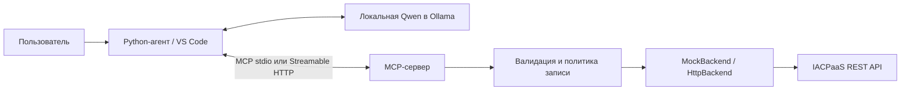

# АТЛАС · IACPaaS × MCP × локальные и облачные модели

Учебный проект по предоставленному путеводителю: один MCP-сервер, агент на Python, запуск из VS Code и конфигурация custom agent. На исходном компьютере используется `qwen-agent` на базе `qwen3.8:27b-q4_K_M`. Веса и локальное окружение не входят в репозиторий; на другом ПК модель нужно настроить отдельно.

Совместная работа в отдельных ветках описана в [CONTRIBUTING.md](CONTRIBUTING.md). Состояние требований и границы проверок: актуальная сверка — [docs/spec-audit.md](docs/spec-audit.md).

По умолчанию используется **учебный backend mock**. Он работает без учётной записи платформы. Реальный REST backend реализован, но для проверки на вашем фонде нужны ключ/JWT и пути собственных ИР.

## Выбор модели

В Web нажмите **Модели и API**: доступны локальная Ollama, OpenAI, Claude, Gemini, DeepSeek и OpenRouter. Выберите API ID, сохраните свой ключ и при необходимости выполните короткую проверку. Облачный режим передаёт вопрос, историю, схемы инструментов и используемые результаты базы провайдеру; расчёты и верификация остаются в MCP. Ключи сохраняются через Windows DPAPI и не публикуются. Подробности и границы проверок: [docs/cloud-models.md](docs/cloud-models.md). История обновлений: [CHANGELOG.md](CHANGELOG.md).

## Веб-интерфейс

Запустите `Start-Web.cmd`: он проверит Ollama и откроет **http://127.0.0.1:8770** в браузере. Скрипт открывает окно управления с кнопками «Запустить всё» и «Остановить всё». Закрытие этого окна останавливает приложение. Приложение доступно только на этом компьютере.

В интерфейсе есть история диалогов и поиск по ней, карточки быстрых вопросов, раскрываемые вызовы MCP с параметрами/результатами, остановка ответа, копирование и скачивание диалога, светлая/тёмная тема. Вкладка «Ресурсы» показывает базы и дерево графа через MCP. При разрешённой записи агент показывает отдельную карточку подтверждения; токен записи остаётся на сервере.

Интерфейс «Атлас знаний» оформлен в собственном стиле: тёмная навигационная панель, фиолетовые и мятные акценты, схема связей и крупная полужирная типографика. Qwen остаётся в памяти между вопросами и выгружается при остановке приложения. Первый запуск модели может занять больше времени.

Диалоги сохраняются в `logs/web.sqlite3` и восстанавливаются после перезапуска. Контекст предыдущих реплик передаётся Qwen; при приближении к бюджету приложение сжимает передаваемую историю, сохраняя полную историю в SQLite. Одновременно модель выполняет один запрос, остальные ждут в очереди. Шаги MCP поступают в браузер по SSE; текст ответа появляется после завершения генерации модели. По умолчанию выбрана локальная модель. Облачный API используется только после выбора провайдера; внешние шрифты не загружаются.

Вручную или через задачу VS Code «IACPaaS: веб-интерфейс»:

```powershell
powershell -NoProfile -ExecutionPolicy Bypass -File .\Start-Ollama.ps1
.\.venv\Scripts\python.exe -m iacpaas_mcp.web --open-browser
```

Порт меняется опцией `--port 8771`. Входные POST/DELETE-запросы защищены локальной проверкой источника и CSRF-токеном; секреты `.env` клиенту не выдаются. История содержит данные диалогов: сохраняйте базу SQLite как обычный локальный файл с данными проекта.

## Быстрый запуск CLI на этом ПК

Для разового консольного вопроса запустите `Start-CLI-Agent.cmd`. `Start-Agent.cmd` открывает общее окно управления Web и Qwen. Пример вопроса к реальной базе:

> Покажи химический состав стали 12Х18Н10Т.

Скрипт запускает локальный Ollama с весами из `D:\LocalLLM\models` на порту **11435**, затем Python-агента. Отдельный порт выбран, поскольку стандартный Ollama на 11434 при проверке не видел эти веса. Существующие профили и настройки другого проекта не менялись.

В PowerShell из папки проекта:

```powershell
powershell -NoProfile -ExecutionPolicy Bypass -File .\Start-Ollama.ps1
.\.venv\Scripts\python.exe -m iacpaas_mcp.agent "Найди справочник материалов и посчитай вершины и дуги"
```

Агент выводит вызовы инструментов и сохраняет трассу в `logs/agent-*.jsonl`. Изменить модель можно через `--model qwen-agent` или `OLLAMA_MODEL` в `.env`. Адрес Ollama задаётся `--ollama-url` или `OLLAMA_URL`. Контекст — 32768 (`AGENT_CONTEXT_LENGTH`), бюджет приложения — 24000 (`AGENT_CONTEXT_BUDGET`), лимит генерации одного решения — 2048 (`OLLAMA_NUM_PREDICT`), thinking отключён, температура 0, до 12 шагов адаптивного цикла. Приложение автоматически сжимает историю и большие результаты при превышении входного бюджета; исходные данные сохраняются локально. Оценка токенов приблизительная. Подробнее: `docs/verification-and-context.md`.

## Установка заново

Нужен Python 3.11+. Для локальных запросов нужна Ollama с моделью, имя которой указано в OLLAMA_MODEL. Start-Ollama.ps1 по умолчанию рассчитан на Windows, порт 11435 и каталог D:\LocalLLM\models; для другого ПК настройте путь параметром -Models и проверьте локальные параметры запуска. Тесты не требуют модели или аккаунта платформы.

```powershell
& "$env:LOCALAPPDATA\Programs\Python\Python311\python.exe" -m venv .venv
.\.venv\Scripts\python.exe -m pip install -r requirements.lock.txt
Copy-Item .env.example .env
```

`requirements.txt` фиксирует прямые зависимости, `requirements.lock.txt` — полный набор проверенного окружения Windows/Python 3.11. На другой ОС используйте `requirements.txt`. Копировать `.env.example` следует при первой установке: существующий `.env` содержит локальные настройки и отдельный случайный токен MCP.

## Архитектура



Основной режим Web и CLI — `adaptive`: модель получает реальные схемы MCP-инструментов и на каждом шаге выбирает инструмент и аргументы, оценивает достаточность результата, продолжает поиск или уточняет вопрос. Диагностические ошибки возвращаются модели для исправления плана. Область доступа и подтверждение записи контролирует Python-хост. Перед ответом приложение повторно проверяет выбранные источники и расчёты по сохранённым снимкам; числа и таблицы отображает код. Ключ платформы остаётся на сервере. Используется собственный Python runtime поверх официального MCP SDK, без LangChain. Архитектура и ограничения: [docs/adaptive-agent.md](docs/adaptive-agent.md).

Для сравнения сохранены `--mode knowledge` (прежний фиксированный предметный план) и `--mode raw` (экспериментальный нативный tool calling, только Ollama). По умолчанию до 12 шагов; CLI `--max-steps` допускает 3–20. Достигнутый лимит означает явно неполный ответ, а не успешное завершение.

## MCP-инструменты

| Инструмент | Назначение | Операция платформы |
|---|---|---|
| `list_inforesources` | Известные пути, фильтр и лимит | Конфигурация; REST-списка нет |
| `get_inforesource` | Корень и метаданные | GET `/api/data/export/user-item`, depth=0 |
| `get_subgraph` | Ветка глубиной 0–5 | Экспорт universal + локальное выделение ветки |
| `count_graph` | Вершины, дуги, ссылки | Полный экспорт + локальный обход |
| `query_knowledge` | Предметный запрос: состав, элементы, свойства, марки, рейтинг и фильтр; готовый проверяемый ответ | Экспорт + детерминированные операции |
| `search_resources` | Поиск по всем подключённым базам, покрытие и ссылки на снимки | Полные экспорты + локальный SQLite-индекс |
| `query_graph` | Поиск имени/значения и метапонятия | Полный экспорт + локальная фильтрация |
| `validate_resource` | Базовая проверка universal JSON | Локально |
| `update_concept` | Изменение вершины | PUT `/api/data/update` |
| `import_inforesource` | Импорт нового ИР/данных | POST `/api/data/import` |

Все инструменты имеют JSON-схемы, описания, структурированные ответы и read/write-аннотации. `root` — путь от корня без имени ИР, полученный из `query_graph`; пустая строка означает весь ИР. Метка с `/` обрамляется символами `‴`, например `‴г/л‴`.

По умолчанию предметный агент имеет доступ ко всем подключённым базам и выбирает подходящий справочник по типу операции через `query_knowledge`. «Область поиска» позволяет по желанию ограничиться одной базой. Индекс хранится локально в `logs/search.sqlite3`, обновляется через 5 минут или с `refresh=true`; ошибки отдельных баз явно отмечаются в покрытии. Поиск охватывает имена, значения и метапонятия графов; бинарные вложения не индексируются.

Предметный ответ ограничен 30 строками показа и 64000 символами (модели он не пересказывается); подсчёты и ранжирование выполняются до ограничения показа. Низкоуровневые ограничения: до 20 совпадений общего поиска за вызов, до 100 результатов `query_graph`/вершин подграфа, до 12000 символов ответа, до 250000 элементов графа, полный экспорт до 128 МБ (ограниченный по глубине — 8 МБ), импорт до 2 МБ. Превышение выдаёт MCP `isError` с диагностикой. Полный экспорт и индекс повторно используются в пределах срока кеша.

Ссылки считаются дугами, а не новыми вершинами; внешние ссылки не разыменовываются. Mock меняется только в памяти процесса. В нём намеренно запрещён импорт поверх существующего ИР: поддерживается импорт новой базы. Проверка JSON базовая; она не доказывает соответствие онтологии, а содержимое BLOB не передаётся модели.

## stdio и защищённый HTTP

stdio запускает сам MCP-хост:

```powershell
.\.venv\Scripts\python.exe -m iacpaas_mcp.server
```

Отсутствие текста в терминале нормально: сервер ожидает MCP-запросы в stdin. Логи отправляются в stderr.

HTTP:

1. Задайте `MCP_BEARER_TOKEN` в `.env`. На этом ПК случайный токен уже создан; он не входит в исходные файлы.
2. В первом терминале запустите сервер:

```powershell
.\.venv\Scripts\python.exe -m iacpaas_mcp.server --transport streamable-http
```

3. Во втором запустите агента:

```powershell
.\.venv\Scripts\python.exe -m iacpaas_mcp.agent "Сколько вершин в базе?" --mcp-url http://127.0.0.1:8765/mcp
```

Сервер слушает только loopback. Без токена и с неверным токеном отвечает 401. Токен MCP и ключ IACPaaS — разные секреты. Статический Bearer предназначен для локальной демонстрации; это не полноценный OAuth-сервер.

## VS Code

Откройте **именно папку IACPaaS-MCP**.

Готовый вариант с вашей Qwen без дополнительных AI-расширений: `Terminal → Run Task → IACPaaS: спросить Qwen`. VS Code запросит вопрос и запустит того же агента в терминале. Также есть задачи запуска Ollama, HTTP MCP и тестов.

Для встроенного AI Chat подготовлены:

- `.vscode/mcp.json` — конфигурация для локального harness VS Code;
- `.mcp.json` — формат для Copilot harness; здесь абсолютные пути этого ПК, их нужно обновить при переносе проекта;
- `.github/agents/iacpaas.agent.md` — custom agent с доступом только к инструментам IACPaaS.

Выберите подходящий harness и один вариант подключения сервера. В актуальном VS Code настройки MCP отличаются между harness: [официальная справка](https://code.visualstudio.com/docs/agents/reference/mcp-configuration).

В `Chat: Manage Language Models` добавьте Ollama с адресом `http://127.0.0.1:11435`, выберите `qwen-agent` в чате и custom agent IACPaaS. Если доступен только OpenAI-compatible провайдер, базовый URL — `http://127.0.0.1:11435/v1`, ключ-заглушка — `ollama`. Возможность подключения зависит от выбранного chat harness/расширения: [модели в VS Code](https://code.visualstudio.com/docs/agent-customization/language-models).

На исходном ПК выполнен вход в GitHub/Copilot, подключена локальная Ollama и выбран custom agent IACPaaS с `qwen-agent:latest`. Встроенный провайдер Ollama помечен VS Code как устаревающий; настройки моделей зависят от версии расширения. Подтверждения результатов инструментов выполняет пользователь. Не включайте автоодобрение записывающих инструментов. Фактические сценарии и границы приёмки описаны в [docs/ide-acceptance.md](docs/ide-acceptance.md).

## Реальная IACPaaS

Откройте кнопку **«Подключение IACPaaS»** внизу боковой панели. Можно изменить логин, пароль и список путей баз, затем нажать «Сохранить и подключить». Вход проверяется через официальный HTTPS endpoint `/api/signin`, а подключение в работающем приложении обновляется сразу. Пустой пароль использует сохранённый только при неизменном логине. JWT/пароль не возвращаются в браузер и не передаются модели. Истёкший сохранённый JWT обновляется через официальный endpoint с сохранёнными данными того же аккаунта; повтор после ошибки допускается только для GET. JWT из переменной окружения автоматически не заменяется: обновите его или переподключите аккаунт.

По явному запросу пользователя логин, пароль и JWT сохраняются в `.local/account.dpapi`, зашифрованные Windows DPAPI для текущего пользователя Windows. Файл и журналы исключены из Git; переносить такое хранилище под другого пользователя Windows нельзя. В `.env` остаются режим и пути ресурсов, но не сохраняемые пароль или JWT. При ручной конфигурации по-прежнему поддерживается `IACPAAS_JWT` или API-ключ из `.env`.

Альтернативный способ изменить подключение — `Connect-IACPaaS.cmd`. В терминале пароль вводится без отображения. Реальный вход и экспорт корней восьми ресурсов аккаунта проверены. Список ресурсов и результаты проверки находятся в локальном `logs/account-resources.json`. Затем выполнен полный поиск по всем восьми ресурсам: справочник материалов содержит 93593 индексируемые вершины. Запрос «12Х18Н10Т» дал одно совпадение, поля сверены с исходным снимком; модель не запускалась.

Официальная документация описывает два способа: JWT через `POST /api/signin` или строковый API-ключ, получаемый у администратора по e-mail. Это разные механизмы; публичная документация не описывает самостоятельную выдачу API-ключа кнопкой в кабинете. REST API предоставляет доступ только к собственным ресурсам аккаунта.

В локальном `.env` заполните:

```ini
IACPAAS_BACKEND=http
IACPAAS_API_KEY=ключ_от_администратора
IACPAAS_KNOWN_IRS=["Учебные/Ваша база"]
```

Вместо API key можно использовать `IACPAAS_JWT`. Ключ передаётся в `X-API-KEY`, JWT — в `Authorization: Bearer`. Пути задаются внутри «Мой Фонд», без e-mail, без префикса фонда и без `$;`. Для импорта нужен путь папки, а JSON передаётся платформе строкой. Используется таймаут 60 секунд.

Начните с `get_inforesource` небольшого своего ИР. Обработчик понимает прямой объект и обёртку `result`, включая JSON-строку. Если платформа вернёт другую структуру, её необходимо адаптировать и добавить обезличенную фикстуру. Чтение живой базы проверено; живая запись не выполнялась. Первое изменение проверяйте на копии ИР.

REST-контракт сверен с [официальной документацией платформы](https://iacpaas.dvo.ru/docs/RemoteCalls/RemoteCalls.html), SDK — с [документацией MCP Python v2](https://py.sdk.modelcontextprotocol.io/).

## Подтверждение изменений

По умолчанию `IACPAAS_ALLOW_WRITE=false`. Чтобы демонстрировать запись, установите `true` и перезапустите сервер.

Первый вызов изменяющего инструмента выдаёт предпросмотр и одноразовый случайный токен на пять минут, привязанный к операции и точным аргументам. Изменения выполняются только при повторном вызове с этим токеном. Попытки записи и успешное завершение отмечаются в stderr событиями `audit_write`; для сохранения серверного журнала можно перенаправить stderr в файл.

Токен сам по себе не подтверждает согласие человека. Python-хост забирает его из ответа, не передаёт модели и запрашивает `ДА` у пользователя. Переданный моделью `confirm_token` удаляется. В произвольном MCP-клиенте подтверждение должен обеспечить сам хост; инструкция custom agent служит дополнением, а не границей безопасности.

Трассы содержат аргументы и результаты инструментов, могут включать данные базы и сохраняются только локально. `.env`, окружение и журналы исключены из Git. Предпросмотры с токенами в трассу не попадают.

## Сценарии демонстрации

1. «Сколько вершин и дуг в доступной базе?» — list → count, ожидаются 8 вершин, 8 дуг, 1 ссылка.
2. «Сколько наблюдений в группе Основные жалобы?» — list → query, ожидаются 2 наблюдения. Ветка содержит также саму группу: это 3 вершины.
3. При выключенной записи: «Переименуй группу Основные жалобы в Главные жалобы» — ошибка политики, данные не меняются. При включённой записи — предпросмотр, отказ или явное `ДА`, затем проверка результата.

Результаты фактических проверок находятся в `docs/verification.md`. Для повторного прогона:

```powershell
.\.venv\Scripts\python.exe -m pytest -q
```

Тесты используют учебные данные, HTTP-заглушки, локальные subprocess/loopback MCP; внешняя сеть и модель не нужны. Проверены графы/ссылки, JSON, REST-параметры, ошибки платформы, отключённая запись, привязка/срок/одноразовость токена, подтверждение и отказ пользователя, отсутствие токенов в трассе, оба транспорта и 401.

Диагностика: если Ollama недоступен — запустите `Start-Ollama.ps1`; если модель не найдена — проверьте порт и каталог весов; 401 от IACPaaS означает проблему ключа/JWT, 401 от MCP — токена MCP; пустой список баз в HTTP backend требует заполнить `IACPAAS_KNOWN_IRS`. После изменения `.env` перезапускайте сервер.


## Вопросы и измерение контекста

В интерфейсе раскройте «Больше вопросов по нашей базе»: доступен 31 сценарий. Данные и ожидаемые результаты: `iacpaas_mcp/static/questions.json`. Они привязаны к текущей учебной базе; после изменения базы ожидаемые количества нужно пересмотреть.

Обычные тесты не загружают Qwen. Реальные проверки запускаются явно:

```powershell
.venv\Scripts\python.exe scripts/benchmark_agent.py --mode database
.venv\Scripts\python.exe scripts/benchmark_agent.py --mode live
.venv\Scripts\python.exe scripts/benchmark_agent.py --mode stress
```

`database` проверяет все 31 предметный запрос через реальный MCP и сравнение со снимками. `live` проверяет 8 вопросов с реальной Qwen, включая параметры плана. `stress` сравнивает 16K и 32K на синтетическом длинном вводе и затем проверяет продолжение диалога из 160 реплик. При live-прогоне модель сохраняется между вопросами и выгружается после всей серии; при смене окон в stress выгружается между профилями. Отчёты сохраняются в `logs/benchmark-*.json`; данные аккаунта и отчёты остаются локальными.

Контекст и бюджет — разные величины: `AGENT_CONTEXT_LENGTH=32768`, `AGENT_CONTEXT_BUDGET=24000`, `OLLAMA_NUM_PREDICT=2048`. История больше не ограничена шестью репликами или отдельным бюджетом 4500: сохраняется весь диалог, который помещается в доступный входной бюджет. Сжатие начинается по размеру. VRAM и общая занятая RAM измеряются раз в две секунды; это выборочные максимумы, не точные мгновенные пики и не память только одного процесса.


## Управление приложением (обновлено 22.10.2026)

- `Start-Web.cmd` или `Start-Agent.cmd` открывает единое окно АТЛАС и запускает веб-сервер с Qwen.
- `Control-App.cmd` открывает то же окно управления без автоматического запуска.
- В окне управления есть кнопки «Запустить всё» и «Остановить всё». Оно остаётся доступным, когда сайт остановлен. Закрытие окна останавливает приложение.
- На сайте есть «Остановить приложение»; после остановки запуск доступен из окна управления или Start-Web.cmd.
- `Stop-Web.cmd` останавливает Web и освобождает память Qwen из Проводника.
- Разовый консольный вариант сохранён в `Start-CLI-Agent.cmd`.

Модель остаётся в памяти между вопросами (`AGENT_KEEP_ALIVE=-1`, `AGENT_UNLOAD_AFTER_REQUEST=false`). При остановке сервера или приложения она выгружается. Служба Ollama без загруженной модели может оставаться запущенной; остальные модели и процессы Ollama приложение не завершает. При принудительной остановке разрешён только PID с сохранённым уникальным маркером нашего веб-процесса.

Для текущей RTX 5070 Ti 16 ГБ выбран `AGENT_GPU_LAYERS=44`, чтобы оставить больше места видеопамяти при контексте 32K. В общем .env.example этот параметр пуст и используется автоматическое распределение. Это аппаратная настройка, её нельзя переносить как универсальную рекомендацию.

Расширенный набор — 31 вопрос в `docs/test-questions.md`. Верификация плана включает явные числовые условия: «не менее 9%» не может молча превратиться в «не более 9%». Al разрешается в существующий класс сплавов на основе алюминия; подсчёт материалов с Cr отделён от рейтинга. Повтор класса в поле subject не создаёт фильтр по имени марки.

Итоговые результаты, включая обнаруженные ошибки и ретест: `docs/benchmark-results.md`.
