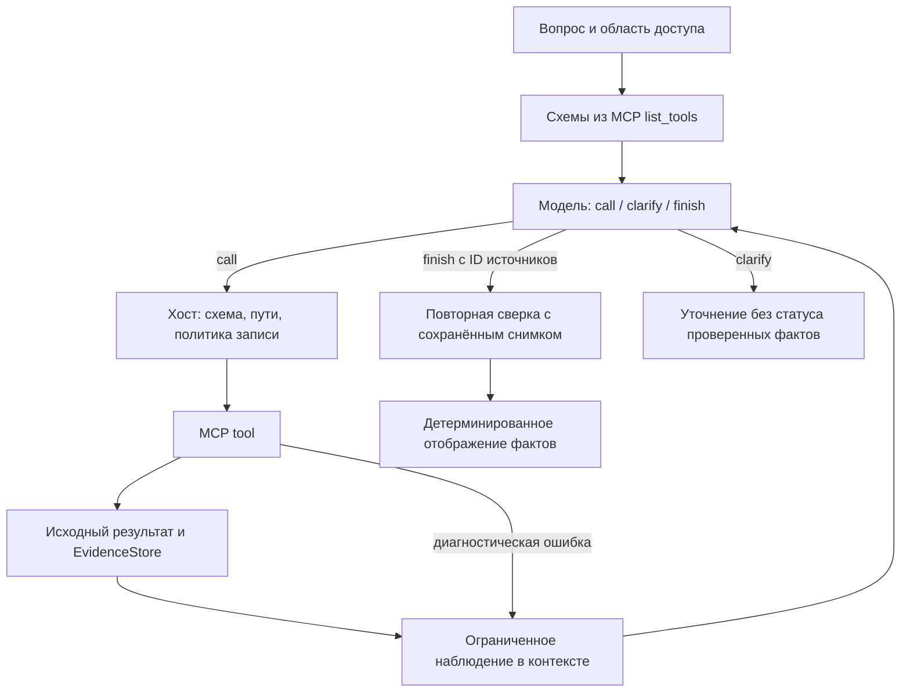

# Адаптивный агент · 23.10.2026

Web и CLI по умолчанию используют `adaptive_agent.run_adaptive_agent`. Это цикл выбора MCP-инструментов, а не сопоставление вопроса заранее написанному ответу. Предметные операции `query_knowledge` остаются ограниченным вычислительным API: онтологии, марки, составы, элементы, свойства, термины, рейтинги и один числовой фильтр. Произвольный составной аналитический запрос может потребовать уточнения или другого набора инструментов.

`decision_schema` включает реальные JSON Schema аргументов всех десяти MCP-инструментов. Поле подтверждения записи скрыто от модели. Ответ модели проверяется локально `jsonschema`; предметный план дополнительно проверяется Pydantic и семантическими ограничениями. Хост предварительно получает подключённые пути и не разрешает доступ вне выбранной области. Путь вершины должен прийти из результата `query_graph`/`search_resources`, а не быть придуман моделью.

Схема выбора дополнительно ограничивает `path` доступными ИР и требует явный `root` у `get_subgraph` (пустой для корня ИР). В контексте сохраняется полная пара: JSON решения assistant → фактические аргументы и результат. Ошибочный вызов также остаётся рядом с диагностикой. Если модель спутала путь ИР и вершины, хост предлагает корректные пары path/root только из уже полученных совпадений; исправление не выполняется автоматически. Это устраняет потерю собственного плана между шагами, обнаруженную при сравнении Web с IDE.

После каждого вызова модель получает результат или ошибку с `code`, `message`, `retryable`, `suggestion`. Она выбирает следующий шаг с учётом этих данных. Повтор одного вызова ограничен двумя попытками. По умолчанию лимит — 12 решений модели; `--max-steps 3..20` меняет его в CLI. Достижение лимита возвращает явно неполные проверенные факты либо диагностическую ошибку, если фактов нет. Внутренние ошибки runtime не маскируются под успешный поиск.

Модель выбирает ID источников для ответа и оценивает достаточность всех частей вопроса. Хост проверяет целостность результата, повторяет вычисления по экспортам и отображает выбранные результаты без свободного пересказа чисел. Вспомогательный каталог не принимается как ответ о материале. Частичный охват, усечение и исчерпанный лимит отмечаются отдельно. `meaning_verified=false`: ни SHA-256, ни повторный расчёт не доказывают правильность понимания естественного языка или истинность самой базы.

Метаданные, найденные вершины и подграф глубиной 1 отображаются таблицами, построенными из проверенного результата. Для большей глубины дополнительно сохраняется полная структура подграфа. Сырые аргументы и результаты доступны в раскрываемых шагах MCP. При исчерпанном лимите показывается последний полученный источник с предупреждением, а не три последние промежуточные выдачи подряд.

Выходы MCP описаны предметными TypedDict: граф, подсчёты, совпадения, покрытие, предметный ответ, запись и ошибка. Сервер строго проверяет успешный результат перед выдачей. Ошибка возвращается как MCP `is_error=true` с JSON в `structured_content` и текстовом блоке. Дополнительные поля самой платформы допускаются в графе; универсальное значение вершины остаётся `Any`.

В Python-хосте запись требует отдельного подтверждения человека после предпросмотра; одноразовый токен не попадает модели или в трассу. Серверная политика запрещает запись по умолчанию. В произвольном MCP-хосте человеческое подтверждение обязан обеспечить этот хост. Живой импорт двух новых собственных ИР проверен после согласия человека; update API вернул серверную ошибку updateVertice. Успешное изменение проверено на mock. См. [live-write-demo.md](live-write-demo.md).

Большие наблюдения сокращаются только для контекста. Исходники остаются на диске, отдельное поле можно прочитать через `read_evidence` по ID и JSON Pointer. При переполнении бюджета старые результаты заменяются ссылками на источники; история сжимается существующим механизмом памяти задач. Схемы, текущий вопрос и последние результаты учитываются в общей оценке. Контекст 32768, входной бюджет около 24000 и выход 2048 — настройки приложения, не обещание скорости или точный подсчёт токенизатором.

Сохранённый JWT платформы обновляется через официальный `/api/signin` при истечении срока или ошибке авторизации, только для того же аккаунта и официального HTTPS endpoint. Одновременные чтения используют одну блокировку обновления. Повтор запроса после обновления разрешён только для GET; мутация автоматически не повторяется. JWT из окружения не заменяется. Текст ошибки платформы и данные входа не выдаются модели.

## Проверка

175 автоматических тестов: зависимые вызовы для Ollama и пяти облачных адаптеров, перепланирование после API-ошибки, недопустимые пути, недостаточные результаты, лимит шагов, человеческое согласие/отказ записи, схемы выходов, бюджет контекста, обновление JWT, существующие проверки доменных операций и транспортов. Модели и API в этих тестах заменены заглушками.

Живая локальная Qwen через stdio получила 93593 вершины, 93592 дуги и 0 ссылок для справочника материалов (`logs/agent-d1218c2282.jsonl`). Тот же сценарий в VS Code описан в `ide-acceptance.md`. Реальные облачные генерации без пользовательских ключей не выполнялись. Локальные трассы, учётные данные и экспорты не публикуются в Git.
