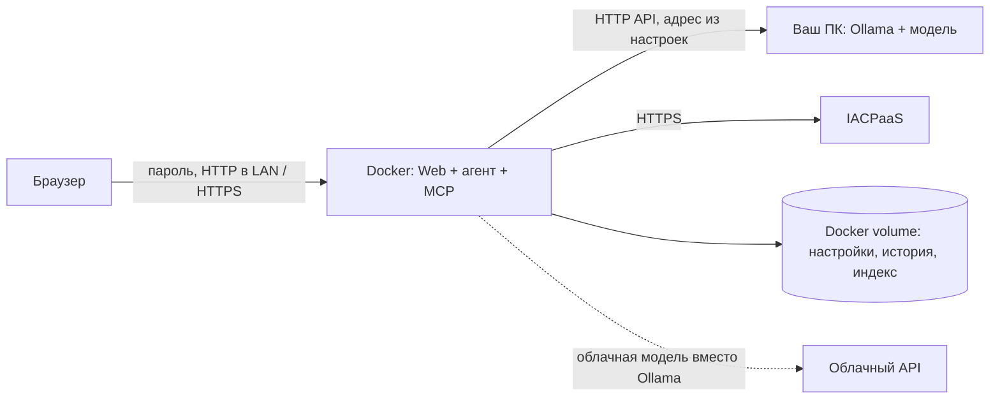

# Docker на Proxmox и отдельная Ollama

Основной вариант развёртывания: **Docker работает в Linux VM на Proxmox; Ollama работает отдельно на вашем ПК**. Контейнер содержит Web, Python-агента и MCP-сервер. Веса модели в образ не входят. Локальные Windows/macOS-скрипты оставлены как вспомогательные средства разработки.



## Подготовка сервера

Используйте VM с Docker Engine и Compose v2; установка в сам гипервизор Proxmox не нужна. Подключение к приватному репозиторию требует приглашённого GitHub-аккаунта.

```sh
git clone https://github.com/Wingtony/IACPaaS-MCP.git
cd IACPaaS-MCP
cp .env.example .env
```

В `.env` задайте:

```dotenv
ATLAS_USERNAME=atlas
ATLAS_PASSWORD=ЗАМЕНИТЕ_НА_СВОЙ_ДЛИННЫЙ_ПАРОЛЬ
ATLAS_ALLOWED_HOSTS=["localhost","127.0.0.1","192.168.1.20","atlas.lan"]
ATLAS_BIND_IP=0.0.0.0
IACPAAS_BACKEND=mock
```

`192.168.1.20` — пример **IP VM, где работает Docker**, а не обязательный адрес самого Proxmox. Укажите свой адрес или DNS. Пароль — не менее 16 символов; можно сгенерировать командой `openssl rand -hex 24`. Не публикуйте `.env`. Одна установка сейчас является общим рабочим пространством: вошедшие пользователи видят общие диалоги, настройки и аккаунт IACPaaS.

```sh
docker compose up -d --build
docker compose logs -f atlas
```

Откройте `http://192.168.1.20:8770`. Браузер запросит `ATLAS_USERNAME` и `ATLAS_PASSWORD`. Это пароль **сайта АТЛАС**, отдельно от входа в IACPaaS. Неизвестные Host запрещены, смена настроек и операции записи дополнительно защищены проверкой Origin/CSRF. `/api/health` открыт без пароля и не отдаёт данные базы.

HTTP подходит для доверенной LAN/VPN. Для доступа через интернет поставьте HTTPS reverse proxy; Basic-пароль нельзя передавать по открытому интернету через HTTP. В `ATLAS_ALLOWED_HOSTS` добавьте точное публичное имя, сохраните исходные `Host` и `Authorization`, передавайте `X-Forwarded-Proto`. Для Uvicorn укажите `FORWARDED_ALLOW_IPS` с адресом доверенного proxy. Не используйте маску `*`.

## Подготовка Ollama на ПК

Оставьте Ollama и модель на ПК. Серверу Docker нужен сетевой адрес Ollama, а не `localhost` браузера. По умолчанию Ollama часто слушает только loopback; разрешите прослушивание LAN и доступ **только с IP вашей VM** в firewall.

Например, Windows PowerShell для отдельного запуска после остановки предыдущего экземпляра Ollama:

```powershell
$env:OLLAMA_HOST="0.0.0.0:11435"
ollama serve
```

Используйте свой установленный каталог моделей (`OLLAMA_MODELS`), если он отличается от стандартного. Уже занятый порт нельзя использовать для второго экземпляра. Для Ollama в трее можно задать `OLLAMA_HOST` в переменных пользователя и перезапустить Ollama. Порт `11435` соответствует исходной конфигурации проекта; стандартный порт Ollama — `11434`.

Linux с отдельно запущенной Ollama:

```sh
OLLAMA_HOST=0.0.0.0:11434 ollama serve
```

Если Ollama управляется systemd, задайте `OLLAMA_HOST` в override сервиса и перезапустите сервис. Windows/Linux firewall должен пропускать выбранный TCP-порт с IP Docker VM. Ollama не предоставляет встроенную защиту паролем в этой конфигурации: не открывайте её порт всему интернету; для разных сетей используйте VPN или защищённый proxy.

## Подключение через сайт

1. Откройте **Модели и API → Ollama · ваш сервер**.
2. Введите адрес ПК, например `http://192.168.1.50:11435`.
3. Введите точное имя установленной модели, например `qwen-agent` (как в `ollama list`).
4. Нажмите **Сохранить выбор**, затем **Проверить сохранённую модель**.
5. Проверка из контейнера покажет доступные модели. Если нужно, выберите/введите одно из этих имён и сохраните ещё раз.

Проверка Ollama вызывает только `/api/tags`, не загружает веса и не генерирует текст. Адрес сохраняется в зашифрованных настройках в volume; после рестарта контейнер использует его для агента и проверки утверждений. `127.0.0.1` внутри контейнера означает сам контейнер. Адрес `host.docker.internal` относится к Docker-хосту; для Ollama на другом ПК указывайте именно IP/имя этого ПК.

При первом вопросе Ollama загружает модель. Приложение отправляет `keep_alive=-1`, поэтому модель остаётся в памяти между вопросами. Контейнер **не запускает, не останавливает Ollama и не выгружает внешнюю модель при смене настроек/завершении Web**. Моделью управляйте на ПК, например `ollama stop qwen-agent`. Выключенный/уснувший ПК означает, что Ollama недоступна; можно выбрать облачную модель.

Облачный режим работает без Ollama: выберите провайдера, API ID и свой ключ. Проверка облачного API — отдельный короткий платный запрос. Провайдер получает вопрос, сжатую историю, схемы и используемые результаты инструментов.

## Данные и обновление

Во вкладке подключения IACPaaS выполните вход и укажите/получите пути ИР. Стартовый mock — отдельная демонстрационная база, а не ваши материалы. Сохранённый вход и найденные пути переживают рестарт контейнера.

Volume `atlas-data` хранит `/data/state` и `/data/logs`: зашифрованные настройки, ключ шифрования Unix, вход IACPaaS, историю, SQLite-индекс и снимки. В Docker используется отдельное хранилище: Windows DPAPI-файлы с ПК туда переносить не нужно — войдите заново. Ключ и зашифрованные файлы нужно резервировать вместе; владелец volume может расшифровать данные. Логи/снимки тоже могут содержать данные базы, поэтому volume не публикуется.

```sh
docker compose stop atlas        # остановить только приложение; Ollama продолжает работать
docker compose start atlas       # запустить прежний контейнер
git pull
docker compose up -d --build     # применить обновления, сохранив volume
docker compose down             # удалить контейнер/сеть, сохранив данные
```

Не добавляйте `-v` к `down`, если хотите сохранить данные. Для контейнера кнопка остановки Web отключена: управление жизненным циклом выполняется через Docker, чтобы политика перезапуска не включала сайт снова после нажатия кнопки.

## MCP в VS Code

Web использует MCP внутри контейнера. Существующий `.vscode/mcp.json` — дополнительный **stdio**-вариант для разработчика с Python-окружением, а не требование для пользователей сайта. Если нужен именно контейнерный stdio MCP, можно запускать из локального VS Code:

```sh
docker compose exec -T atlas python -m iacpaas_mcp.server
```

Команду выполняют там, где доступен Docker Compose этого проекта. Для удалённого сервера нужен SSH/VS Code Remote SSH; Docker socket не публикуется в сеть. HTTP MCP имеет отдельную bearer-авторизацию и не включён наружу по умолчанию.

## Что проверено

Локально проверены Python-тесты с подменой внешних API и сценарий «Atlas на другом хосте → Ollama на ПК»: сохранение адреса, выбор модели, проверка списка, аутентификация, Origin/CSRF и независимость жизненных циклов. Реальный Proxmox-хост и его сеть этой проверкой не покрыты. Docker на исходном Windows-компьютере не установлен; сборку образа и запуск mock-контейнера выполняет отдельный GitHub Actions job. Его результат следует смотреть в PR.
