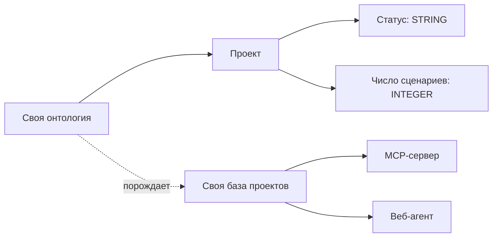

# Собственные графы в IACPaaS · 23.10.2026

После отдельного согласия пользователя на точный манифест созданы два новых собственных ИР в «Загрузки»:

- `АТЛАС - онтология проектов 20261023-011212-0b36b450`;
- `АТЛАС - учебные проекты 20261023-011212-0b36b450`.

Выданные базы не входили в разрешённые пути записи. Данные синтетические; схема базы задана новой собственной онтологией.



| Запись | Статус после проверки | Число сценариев |
|---|---|---|
| MCP-сервер | учебный пример | 2 |
| Веб-агент | учебный пример | 3 |

Числа — учебные значения, не отчёт о числе реализованных функций приложения.

| Операция | Фактический результат |
|---|---|
| Проверка JSON | Локальный validate пройден; целевая база также проверена по официальной universal JSON Schema |
| Предпросмотр | pending_confirmation; до согласия вызовов изменяющего backend — 0 |
| Создание онтологии через MCP import_inforesource | Успешно; повторный count_graph: **4 вершины, 3 дуги, 0 ссылок** |
| Создание базы через MCP import_inforesource | Успешно; повторный count_graph: **7 вершин, 6 дуг, 0 ссылок** |
| Изменение только статуса Веб-агента | API update отклонил внутреннюю операцию; успех не заявляется |
| Повторное чтение после отказа update | Статус остался **учебный пример**; остальные поля сохранены |
| Чтение существующих ресурсов через --inspect | Пройдено, без LLM, импорта и обновления |

Использованы точные JSON манифеста, `clear_if_exists=false` и отдельные одноразовые токены предпросмотра. Согласие человека относилось к двум конкретным новым ИР и одной конкретной смене статуса. Токены не попадали в отчёт. RestrictedDemoBackend разрешает только точные операции манифеста; другие ИР и включение очистки отклоняются до обращения к платформе.

## Ошибка живого обновления

`PUT /api/data/update` по официальному контракту вернул HTTP 200, `success=false`, объяснение **«Неожиданное значение параметра action: updateVertice»**. Пути сверены по экспорту обоих новых ИР. После первого отказа чтение подтвердило прежнее значение; один отдельный диагностический повтор получил ту же ошибку. После этого запись не повторялась.

Это наблюдаемая серверная ошибка данного прогона. Редактирование через интерфейс платформы не проверялось. Адаптер возвращает `platform_operation_unavailable`, `retryable=false`: агент должен сообщить о состоянии платформы, а не менять пути или повторять мутацию. Автоматического обхода через очистку/перезапись нет. Демонстрация возвращает `created_update_unavailable` (CLI exit code 2), а не `passed`.

Живое создание и подтверждение записи проверены. Успешное изменение вершины покрыто mock-тестами; его подтверждение на живом update API зависит от исправления/разъяснения платформы.

## Как показать уже созданное

```powershell
.\.venv\Scripts\python.exe -X utf8 -m iacpaas_mcp.demo --inspect logs/demo-20261023-011212-0b36b450/manifest.json
```

Команда только читает два ресурса манифеста. После следующего запуска сайта они доступны во вкладке «Ресурсы»: пути добавлены к восьми прежним. Основной сайт сохраняет `IACPAAS_ALLOW_WRITE=false`.

Локальные доказательства: `logs/demo-20261023-011212-0b36b450/manifest.json`, `report.json`, `update-response.json`, снимки `logs/exports`. SHA-256 утверждённого манифеста: `24f8976da2bbaf6ce9a81a07b75238b5146a635934453586fa16838c7145e987`. Они исключены из Git; опубликованы синтетический генератор и этот отчёт.

Контракт сверен 23.10.2026: [CRUD API](https://iacpaas.dvo.ru/docs/RemoteCalls/RemoteCalls.html), [формат графов](https://iacpaas.dvo.ru/docs/Json/Json.html), [JSON Schema](https://iacpaas.dvo.ru/docs/Json/target-ir.schema.json), [OpenAPI](https://iacpaas.dvo.ru/v3/api-docs).
